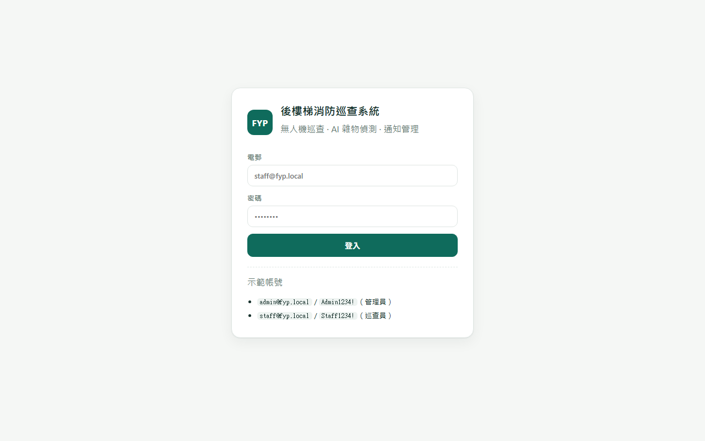
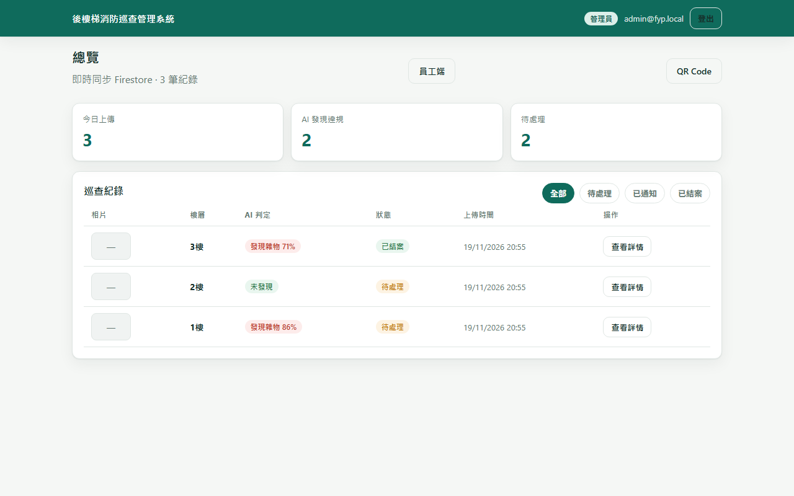
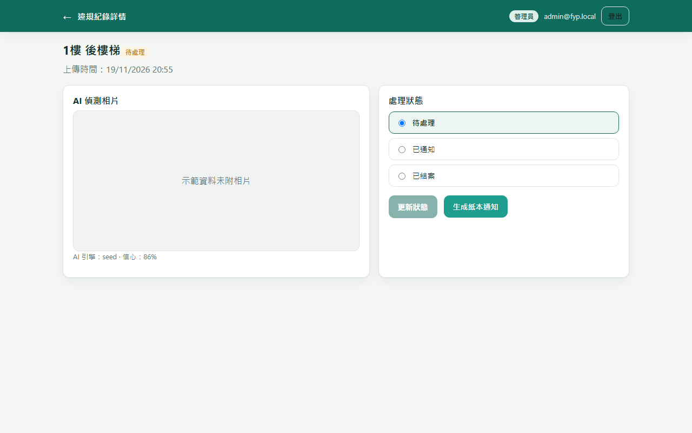
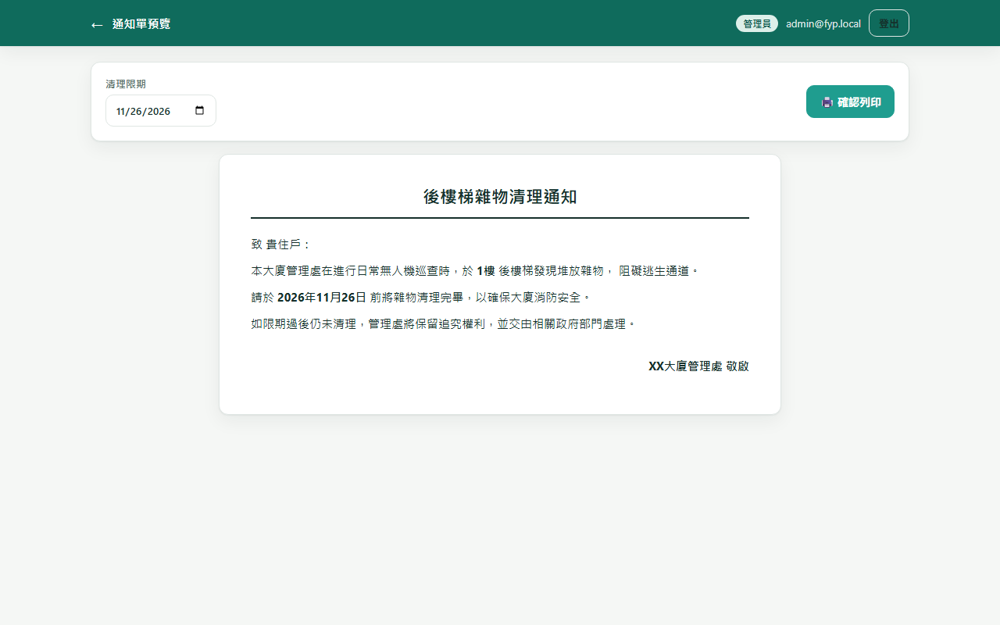
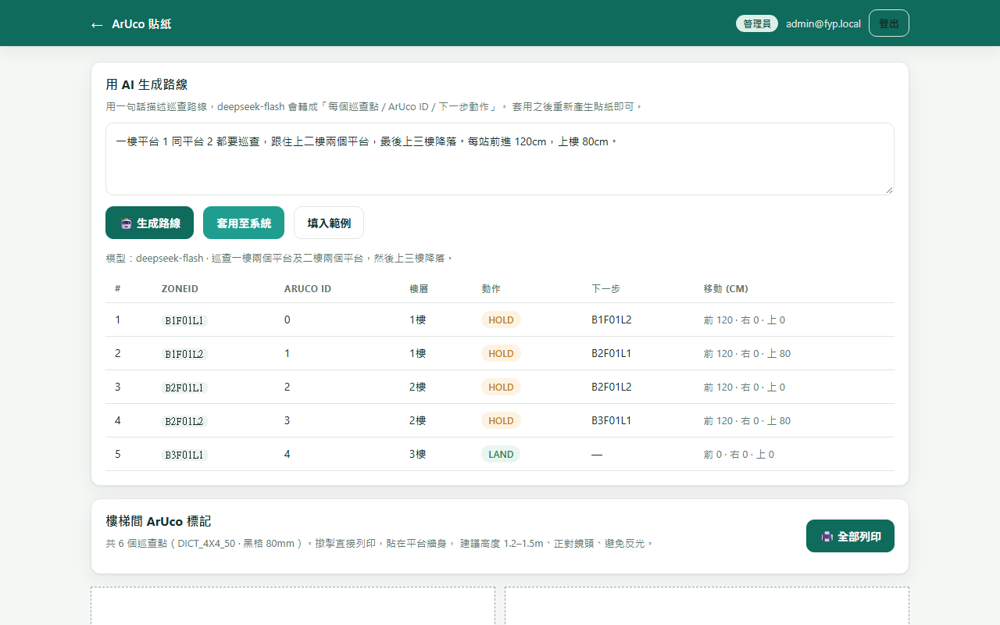

# FinalYearProject — 後樓梯消防巡查管理系統

用無人機巡查大廈後樓梯、AI 偵測堆放雜物，再由管理員跟進、更新狀態、發出紙本清理通知。
前端 **React + Vite**，後端 **Firebase（Firestore + Storage + Auth + Hosting）**，冇自建伺服器。

- 線上版：<https://fyp-backstair.web.app>
- Firebase 專案：`fyp-backstair`（Firestore 位於 asia-east2）

## 畫面

| 登入 | 管理員總覽 |
|---|---|
|  |  |

| 違規詳情 | 通知單 |
|---|---|
|  |  |

員工端（手機）：<docs/screenshots/05-staff.png>

---

## 快速開始

```powershell
npm install
copy .env.example .env      # 已有 .env 就唔使
npm run dev                 # http://127.0.0.1:5173
```

### 示範帳號

| 角色 | 電郵 | 密碼 |
|---|---|---|
| 管理員 | `admin@fyp.local` | `Admin1234!` |
| 巡查員 | `staff@fyp.local` | `Staff1234!` |

角色唔係靠 email，而係 `users/{uid}.role` 文件（`admin` / `staff`），由 Firestore rules 讀取。

---

## 目錄結構

```
src/
  firebase.js            Firebase 初始化（Auth / Firestore / Storage）
  App.jsx                路由
  context/AuthContext.jsx onAuthStateChanged → 讀 users/{uid} 角色
  components/
    RequireRole.jsx      路由守門（未登入 → /login，角色不符 → 403）
    AppBar.jsx           頂欄（角色、身份、登出）
    Loading.jsx
  pages/
    Login.jsx            電郵密碼登入
    StaffHome.jsx        員工端：樓層進度、影相上傳、今日紀錄
    AdminDashboard.jsx   管理員總覽：統計 + 即時列表 + 篩選
    RecordDetail.jsx     單筆詳情：相片、更新狀態
    PrintNotice.jsx      通知單預覽、改限期、登記 + 列印
  lib/
    inspections.js       Firestore / Storage 存取（唯一寫入點）
    aiDetector.js        AI 偵測 stub（換真模型只改呢個檔）
    img.js               上傳前壓縮（最長邊 1280px、JPEG 0.75）
    format.js            日期／時區工具
firestore.rules          資料存取權限
storage.rules            圖片存取權限
firestore.indexes.json   索引（目前冇需要，保持空白）
firebase.json            hosting / firestore / storage 部署設定
scripts/seed.mjs         寫入示範巡查紀錄（npm run seed）
scripts/screenshots.mjs  用 CDP 截圖做視覺驗證
test/rules.test.mjs      rules 單元測試（emulator）
```

---

## ArUco 標記（無人機導航用）

用 **ArUco `DICT_4X4_50`** 而唔係 QR：ArUco 可以做到 pose estimation，
即係唔止認得「面前係 marker 0」，仲算得出**距離 1.2m、偏右 0.15m**，閉環飛近才可行。

- **保安零輸入**：`/admin/markers` 一頁列印全部 6 張貼紙，唔需要打任何字
- 列印檔：[docs/aruco-sheet.pdf](docs/aruco-sheet.pdf)（6 張 A6，黑格 80mm）
- 產生／改路線：`python tools/drone/gen_markers.py`（會同時更新 `public/markers/markers.json`）
- 巡查點（zone）設定：`scripts/seed-zones.mjs`

> 列印必須揀「實際大小 / 100%」。黑格印細了，距離會估細；`markers.json` 的 `markerSizeM` 必須同實物一致。

無人機側（Tello Talent）在 `tools/drone/`：

```powershell
cd tools\drone
python -m pip install -r requirements.txt
python gen_markers.py                    # 產生貼紙
python aruco_test.py                     # 合成影像驗證距離/角度準確度（唔使飛）
python aruco_nav.py --camera 0           # 用 webcam 試偵測
python aruco_nav.py --fly --takeoff --approach   # 真飛並飛近 marker（先讀 SAFETY.md）
```

實測（`aruco_test.py`，8cm 黑格、fx=900）：0.5–3m 距離誤差 ≤ ±2.5%、橫向誤差 <1cm、
可偵測上限約 3.5m。詳細見 `tools/drone/README.md`。

## AI 生成路線（deepseek-flash）

`/admin/markers` 上面有個輸入框：用一句話講路線，AI 會轉成「每站 zoneId / ArUco ID / 動作 / 位移(cm)」，
撳「套用至系統」就寫入 Firestore `zones`，再重新產生貼紙即可。



**架構（安全重點）**

```
瀏覽器 → Cloud Function generateRoute (asia-east1)
        → DeepSeek API（key 存 Google Secret Manager）
        → Firestore zones（Admin SDK，繞過 client rules）
        → python tools/drone/gen_markers.py --from-firestore 重出貼紙
```

- **API key 唔會出現在前端**：只存 Secret Manager，前端只拿到已驗證的 JSON
- 呼叫前檢查 `users/{uid}.role === 'admin'`，非管理員會被擋
- AI 輸出有嚴格驗證：markerId 0–49 不重複、action 白名單、`nextZone` 必須存在、位移限制 ±300cm
- 每次生成都寫 `routeLogs`（prompt / 結果 / token 用量），方便報告寫「用了多少 token」

**部署 function**

```powershell
firebase functions:secrets:set DEEPSEEK_API_KEY --data-file key.txt   # 只需做一次
firebase deploy --only functions
```

**改路線之後重新出貼紙**（需要一次性 service account）

```powershell
# 1. Firebase console → 專案設定 → 服務帳戶 → 產生新的私密金鑰
# 2. 指向該 JSON
$env:GOOGLE_APPLICATION_CREDENTIALS = "C:\path\serviceAccount.json"
python tools/drone/gen_markers.py --from-firestore
```

## 資料模型

```
users/{uid}
  role: 'admin' | 'staff'
  email, displayName

inspections/{id}
  floor: string (≤20 字)
  photoPath: string            Storage 路徑（可空）
  aiDetected: boolean
  aiConfidence: number         0–1
  aiEngine: string             例如 'stub-v0（未接駁 .pt 模型）'
  note: string
  status: '待處理' | '已通知' | '已結案'
  createdAt: timestamp         serverTimestamp（rules 驗證 == request.time）
  createdBy: uid

notices/{id}
  inspectionId, floor
  deadline: 'YYYY-MM-DD'       rules 用 regex 驗格式
  printedAt: timestamp
  createdBy: uid
```

### 權限（`firestore.rules`）

| 動作 | 巡查員 | 管理員 |
|---|---|---|
| 讀巡查紀錄 | ✅ | ✅ |
| 新增巡查紀錄（只可以自己名義、狀態必須「待處理」） | ✅ | ✅ |
| 改狀態 | ❌ | ✅（只准改 `status` / `updatedAt` / `updatedBy`） |
| 讀／寫通知 | 只讀 | 建立 |
| 改 `users/{uid}` | ❌ | ❌（只由 Admin SDK／種子腳本寫） |

Storage：登入者可讀寫 `inspections/{id}/*`，限 2MB 及 `image/*`。

---

## 流程

1. 巡查員登入 → 選樓層、影相 → 相片壓縮後上傳 Storage → `aiDetector` 出判定 → 寫入 `inspections`（狀態 `待處理`）
2. 管理員登入 → 總覽即時（`onSnapshot`）見到新紀錄與統計
3. 開詳情 → 揀狀態 →「更新狀態」寫回 Firestore
4. 「生成紙本通知」→ 改清理限期 →「確認列印」先寫 `notices` + 把巡查紀錄改「已通知」，再開瀏覽器列印

---

## 部署

```powershell
npm run build
npx firebase deploy --only hosting,firestore:rules,firestore:indexes,storage --project fyp-backstair
```

首次設定（已做過，換機／換帳號時參考）：

```powershell
firebase login
firebase use fyp-backstair
```

---

## 測試

```powershell
npm run test:rules     # 需要 Java（Firestore emulator）
```

測試涵蓋：未登入被擋、巡查員不能改狀態、不能冒認別人、狀態值白名單、管理員只准改狀態欄位、通知限期格式、`users` 文件不可由客端修改。

AI 偵測的 stub（`aiDetector.js`）只用圖片內容做啟發式，**唔係真模型**；介面與資料欄位已預留，換成 Cloud Function 呼叫 `backstair_5class_v5_candidate_best.pt` 只需改該檔。

---

## 已知限制

- **AI 未真正接入**：`.pt` 模型未部署成推論服務，`aiDetector.js` 係佔位實作
- **無人機控制未接駁**：員工端「開始巡查／暫停／繼續」停用
- **冇註冊／忘記密碼**：帳號由管理員建立（示範用 Admin SDK 或 console）
- **通知冇列表頁**：資料寫入 Firestore，但管理員介面暫時只由巡查詳情進入列印
- **限額**：Firestore 免費層每日 50k 讀取；Storage 5GB；正常 FYP 用量唔會超
- 圖片以 Storage 路徑存，冇做縮圖／多尺寸
